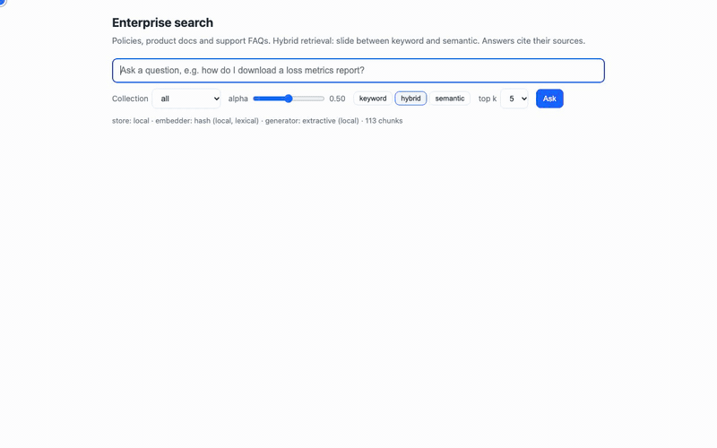

# Enterprise search RAG demo

Hybrid search (dense semantic + sparse keyword) over three internal collections — **policies**, **product docs** and
**support FAQs** — with answers that cite their sources. Pinecone + OpenAI when keys are present; a fully local mode
otherwise, so the demo runs on a laptop with no accounts at all.

## Quick start (no keys)

```bash
python3 -m venv .venv && .venv/bin/pip install -e ".[dev]"
.venv/bin/python tools/make_corpus.py          # writes corpus/ (12 product docs, 12 policies, 25 FAQs)
.venv/bin/python -m rag ingest                 # chunks, BM25, embeddings, local index under data/index/
.venv/bin/python -m rag ask "How do I download a loss metrics report?"
.venv/bin/python -m rag ask "which scenarios use the hybrid footprint" --alpha 0 --collection product-docs
.venv/bin/python -m rag eval --misses          # recall@5 and MRR: dense vs sparse vs hybrid
.venv/bin/python -m rag serve                  # http://127.0.0.1:8000 — question box, alpha slider, cited answer
```

`python -m rag info` prints which store, embedder and generator are configured (never the key values).

## Demo recording



`docs/demo/demo.mp4` is the same walkthrough as video (52 s, 1280×800); the raw `.webm` the script writes is git-ignored. It shows an FAQ question at the
default hybrid alpha, an identifier query (`HFP`) in keyword-only mode on product docs, a policy question with the slider
dragged toward semantic, and a question the corpus cannot answer, which the generator declines. Re-record it against a
running server with:

```bash
.venv/bin/pip install playwright imageio-ffmpeg && .venv/bin/python -m playwright install chromium
.venv/bin/python tools/record_demo.py            # writes docs/demo/demo.{webm,mp4,gif}
```

## Switching to Pinecone + OpenAI

Copy `.env.example` to `.env` and set `OPENAI_API_KEY` and/or `PINECONE_API_KEY`, then run `ingest` again (and
restart `serve` if it is running; it also reloads by itself when `data/index/bm25.json` changes). The embedder and the
generator switch on the OpenAI key alone; the store switches to Pinecone only when **both** keys are set, because an
index built from hash embeddings would be junk and its dimension is fixed at creation.

| Component | key absent | key present |
|---|---|---|
| Dense embeddings | `HashEmbedder`: deterministic hashed bag of tokens, 256-d. **Lexical, not semantic.** | OpenAI `text-embedding-3-small`, 1536-d |
| Vector store | `LocalStore`: numpy, persisted to `data/index/` | Pinecone serverless, `metric="dotproduct"`, sparse-dense vectors, one namespace |
| Answer generation | `ExtractiveGenerator`: first sentences of the top passages, each with its `[n]` | OpenAI `gpt-4o-mini`, temperature 0, passages-only prompt |

The first `ingest` in Pinecone mode creates the index (dimension from the embedder) and waits for it to be ready. An
existing index with a different dimension or a metric other than `dotproduct` is refused with a clear error before
anything is deleted. `RAG_MODE=local` forces the local store; `RAG_MODE=pinecone` forces Pinecone. The BM25
vocabulary (`data/index/bm25.json`) is written by `ingest` on the machine that ran it; another machine querying the
same Pinecone index needs a copy of that file. The Pinecone path is covered by tests against a fake client only; it
has not yet been run against a live index.

## How hybrid retrieval works here

- **Chunking** is Markdown-aware: split on headings, then ~350-word windows with 60 words of overlap. Each chunk
  carries its heading path, so a citation can say *Footprint module › Hybrid footprint (HFP)*.
- **Sparse** vectors come from a BM25 encoder fitted on the corpus (`rag/sparse.py`). Tokens keep underscores and
  digits, so identifiers such as `fullCompanyYlt` or `3CI` are whole terms. Document vectors hold BM25 weights, query
  vectors hold idf per term, and both are L2-normalised.
- **Dense** vectors are unit length, so the dense dot product is the cosine.
- **Hybrid score** = `alpha · dense + (1 − alpha) · sparse`. The sparse term is in `[0, 1]` (non-negative BM25
  weights, unit-normalised). The dense term is a cosine: in `[0, 1]` for the hash embedder (unsigned counts) and in
  practice for OpenAI embeddings; the local store clamps a negative cosine to 0. Both terms are bounded, which is what
  makes `alpha` meaningful (`1.0` dense only, `0.0` sparse only, `0.5` the default), but the two score distributions
  are not identical, so compare alphas with the eval rather than by eye. Pinecone computes the same blend when the
  query's dense values are scaled by `alpha` and the sparse values by `1 − alpha`; the local store does it in numpy.
  A chunk with a score of 0 is not a hit.
- **Citations**: the generator sees passages numbered `[1]..[k]` and must cite by number. The response lists only the
  numbers actually used (`citations`) and everything retrieved (`sources`), each with title, heading, collection, URL,
  score and a snippet. When nothing fits, the generator answers *I could not find this in the indexed documents.*
  The OpenAI generator decides that from the passages' content. The local extractive generator has no judgement, so
  it uses two checks that do not depend on the alpha chosen: the best passage's evidence (the hybrid score at
  alpha 0.5, from the store's dense and sparse components) must reach `min_score=0.15`, and at least half of the
  question's content words must exist in the corpus vocabulary. Both are heuristics; the eval's `declines` column
  shows how they behave on the no-answer queries at each alpha.

## What the eval shows

`eval/queries.jsonl` holds 26 queries: identifier-heavy ones (`fullCompanyYlt`, endpoint paths, "HFP") where keyword
search should win, paraphrases ("working from another country", "accounts when someone leaves") where semantic search
should win, FAQ near-duplicates, and two questions with no answer in the corpus. `python -m rag eval` prints, for each
alpha, recall@5 and MRR overall and per collection **of the expected document**, plus `declines` (how many of the
no-answer queries the generator declined). `--misses` lists the queries each setting missed and any no-answer query
it answered anyway. Some queries carry a collection filter and some do not, as a user would; the rows are a
description of this query set, not a controlled benchmark.

In local mode the hash embedder is lexical, so "dense" is really a second keyword signal and the paraphrase queries are
the ones that miss. With OpenAI embeddings those are the queries hybrid is expected to recover while keeping the
identifier queries that pure dense retrieval tends to blur. Run the eval in both modes and compare the per-collection
rows: that comparison is the point of the demo.

## The corpus

- `corpus/product-docs/` — 12 articles written from CyberCube's **public** documentation digest (docs.cybcube.com, Cat
  Model v6). Every article links to its real section. `tools/crawl_docs.py` can replace them with the live articles
  once a docs API token is available; it is unverified until then.
- `corpus/policies/` and `corpus/faqs/` — **fictional** sample content written for this demo. Every file says so in its
  front matter (`fictional: true`), the UI and CLI label those sources, and the generator prompt is told they are demo
  content. Internal-only material (Confluence, repo internals) is deliberately not indexed, because embedding sends
  text to OpenAI and Pinecone.

`tools/make_corpus.py` regenerates all three collections from the texts inside it.

## Layout

```
rag/settings.py    .env → Settings; per-component mode selection; describe() never prints secrets
rag/documents.py   front matter + corpus loader (duplicate ids are an error: citations must be unambiguous)
rag/chunking.py    heading-aware windows with overlap
rag/sparse.py      tokenizer + BM25 encoder (vocab ids = Pinecone sparse indices), save/load JSON
rag/dense.py       Embedder protocol: HashEmbedder, OpenAIEmbedder
rag/store.py       VectorStore protocol: LocalStore (numpy, persisted), PineconeStore (serverless, dotproduct)
rag/generate.py    citations, ExtractiveGenerator, OpenAIGenerator and its prompt
rag/pipeline.py    ingest() and ask(); Retriever = embedder + BM25 + store
rag/evaluate.py    recall@k / MRR per alpha and per collection
rag/cli.py, rag/api.py, static/index.html, demo.ipynb
tests/             no network, no keys; PineconeStore tested against a fake client
```

## Retrieval trade-offs, briefly

- **Keyword** wins on identifiers, codes, report and field names, and on FAQ titles that nearly match the query. It
  cannot bridge vocabulary gaps ("abroad" vs "another country").
- **Semantic** wins on paraphrase and vague phrasing, which is how people search policies. It blurs identifiers and can
  rank a fluent but wrong passage above the exact one.
- **Hybrid** with a plain convex weight is the simplest combination that lets you show both behaviours with one slider.
  Reciprocal-rank fusion or a cross-encoder re-ranker are the usual next steps; both are easy to add behind
  `Retriever.search` without touching the stores.
- **Chunk size** trades citation precision against context: smaller chunks cite more precisely, larger ones answer
  multi-step questions better. 350 words with heading context is a reasonable middle for documentation.
